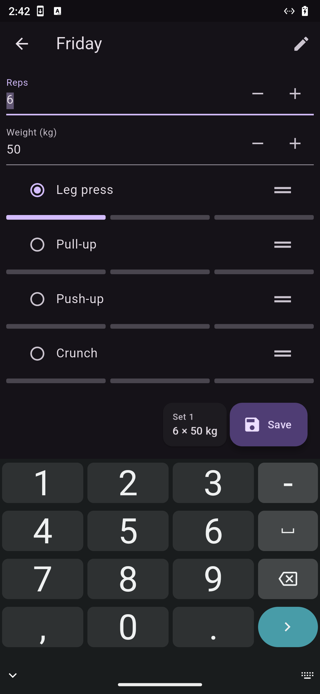

# Start Plan keyboard dock — Android proof (20 November 2026)

- **Device:** Waydroid Android 13 (x86_64), screen `1080 × 2340`, density `420dpi` (`2.625px/dp`).
- **App:** Flex 2.2.47 release-mode APK, built locally from the fix. Open **Plans → Friday**, save a `6 × 50 kg` set, then tap **Reps** to reopen the actual Android numeric keyboard.
- **Keyboard top:** `y=1547px` from `adb shell dumpsys window`, visible `ITYPE_IME frame=[0,1547][1080,2340]`.
- **Save:** bounds `x=775, y=1358, width=263, height=147`, bottom `y=1505px` from Android UI accessibility.
- **Set 1:** bounds `x=550, y=1358, width=215, height=147`, bottom `y=1505px`.
- **Measured live gap:** `(1547 - 1505) / (420 / 160) = 16dp` **for both Save and the preview**, with the keyboard visible.
- **Regression test:** `keyboard dock accounts for Android gesture-navigation inset` failed **before** the change (`40dp` actual vs `16dp` required) and passed after the change (`16dp`). The test models `SafeArea(maintainBottomViewPadding: true)`, keyboard inset 300dp, and gesture-navigation safe area 24dp.
- **Validation:** `flutter analyze --no-pub` clean; `flutter test --no-pub` all 594 tests passed; live APK installed and visually checked on Waydroid.

This is raw device evidence, not a mocked screenshot. The changes use the actual Android bottom view padding rather than hard-coded additional spacing.

## Keyboard opening/closing regression (20 November 2026)

[Waydroid frame-captured Android recording](start-plan-keyboard-transition-waydroid.mp4)

The next regression test reproduces the previous transition bug: with only a 20dp keyboard inset, Save jumped **108dp**, crossing the bottom dock. `keyboard transitions never move Save through the bottom dock` now samples **21 keyboard positions** across opening and closing with a 24dp Android gesture inset. It asserts that the Save row stays 16dp above the higher of the visible keyboard or dock, that previews track Save, and that the FAB never moves farther between samples than the keyboard itself moves.

The new `_StartPlanDockLocation` is used continuously rather than swapping locations when the IME becomes visible. The FAB row keeps a constant height/padding. Waydroid was rebuilt from these changes and the recorded open/close sequence was visually inspected.

The Android 13 Waydroid video was assembled from 40 unmodified device screenshots at approximately 5fps because that Waydroid build's `screenrecord` native video encoder was unavailable. No screen contents were simulated or drawn.
